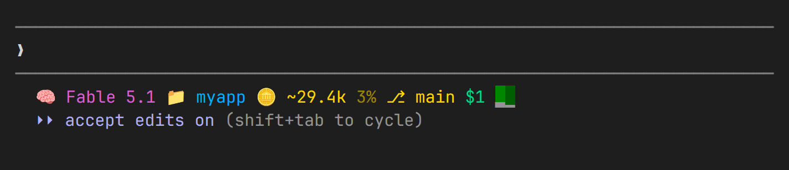
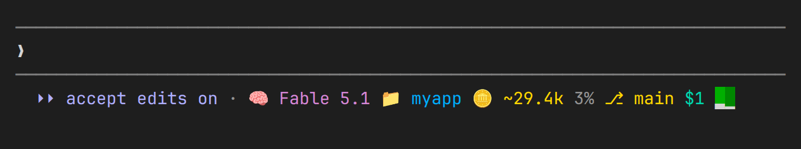

# statusline-footer

Merge Claude Code's status line into the mode line. It runs the same command your
`statusLine` setting runs, feeds it the same JSON, and draws the result on the mode line
row, right after the mode indicator, instead of on a row of its own:

```
⏵⏵ auto mode on · 🧠F5.1 📁my-project ⎇ main $0.42
```

That saves one terminal row, which is helpful on phones. No status line script changes
are needed; the mod only changes where its output is drawn.

Before, with the `statusLine` setting (the status line takes a row of its own below the
prompt):



After, with the mod (the same line sits on the mode line row):



## Install

At the prompt of a terminal session:

```
/plugin install statusline-footer --marketplace erikus/statusline-footer
```

Answer `y` to add the marketplace, then pick a scope (user is first). From a shell the
same is `claude plugin install statusline-footer --marketplace erikus/statusline-footer`.
In the desktop app, click + next to the prompt box, then Plugins, Add marketplace with
`erikus/statusline-footer`, then Add plugin.

Then remove the `statusLine` entry from `~/.claude/settings.json`, or the status line is
drawn twice. To go back, uninstall the mod and put the entry back, for example:

```json
"statusLine": { "type": "command", "command": "~/.claude/statusline.sh", "padding": 0 }
```

## Options

| Option             | Default                 | Meaning                                                                 |
| ------------------ | ----------------------- | ----------------------------------------------------------------------- |
| `script`           | `.claude/statusline.sh` | The status line command, as a path under your home folder.              |
| `indicatorColumns` | `23`                    | Columns the mode indicator takes before the line (margin + label + " · "). |

The mod cuts the script's output so the row doesn't wrap. `23` fits "accept edits on", the
longest common label. Lower it to `20` if you always run in auto mode, or raise it to `29`
for "bypass permissions on". If no file exists at the `script` path,
the row says so and names the path.

Change it in `/config` under the plugin's row. The install step may say the option is
"not yet set"; the default applies until you set it.

## What the script receives

The mod builds the status line JSON from the session: `model.display_name`, `version`,
`cwd`, `workspace.current_dir`, `workspace.project_dir`, `session_id`,
`cost.total_cost_usd`, `cost.total_duration_ms`, `context_window.total_input_tokens`,
`context_window.used_percentage`, `context_window.context_window_size`,
`rate_limits.<kind>.used_percentage`, and `exceeds_200k_tokens`. Fields the mod cannot
see are left out: `output_style`, `transcript_path`, and `cost.total_api_duration_ms`.
A script that reads one of those should treat it as absent.

`COLUMNS` is set to the room left on the row after the mode indicator, so a script with
responsive tiers picks the right one. Only the first line of output is drawn.

ANSI colors in the output (16-color, 256-color, and truecolor foreground and background,
dim, bold) are kept. Other escape sequences are dropped.

## Refresh

The line is refreshed at session start, at the start and end of each turn, after every
tool call, and every 30 seconds while idle. It is redrawn only when the output changed.

## Development

```
claude plugin validate .
claude plugin test .
claude --plugin-dir .
```

## License

MIT
